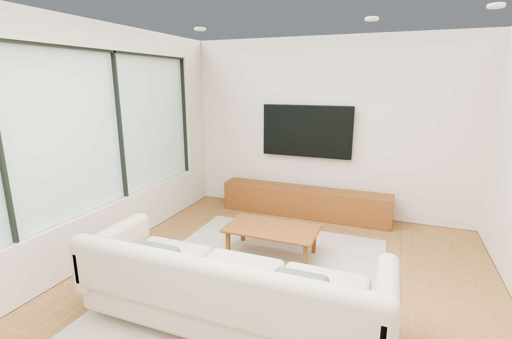
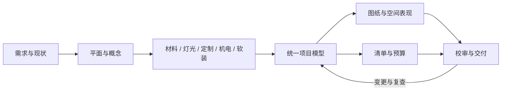

# 室内设计全流程 · 15 Skills v2

用统一项目数据衔接需求、测量、平面、概念、空间表现、材料、灯光、定制、机电、图纸、软装、预算、校审和交付配合。

15个可独立安装的 Skills、共享项目模型、二维出图与预算工具，以及两个可浏览的项目案例。



v2新增[折庭84㎡ L形跨户型测试](projects/TEST-L-084/README.md)：通用二维工具支持正交凹轮廓、偏移坐标、任意对象编号、显式柜体正面、材料铺装及可选设备。一次衣柜变更已贯通图纸、清单与26行预算。原96㎡示范交付与历史执行记录保持冻结。详见[复用升级与价值验证](docs/复用升级与价值验证.md)。

## 快速使用

```bash
git clone https://github.com/liuqing0224/interior-design-skills.git
cd interior-design-skills
python3 install.py --target ~/.codex/skills
python3 install.py --target ~/.codex/skills --check
```

安装器先检查全部同名目录，存在冲突时不写入；不会覆盖其他技能。安装后在新会话使用：

更新本项目已安装版本时，可用`python3 install.py --update-from <上次交付包根目录> --target ~/.codex/skills`。只有安装内容与已知旧版或当前主版本字节一致时才更新；任何本地改动/未知内容均停止。旧文件保留在目标父目录的`interior-skill-backups`，更新失败自动恢复已替换目录。

```text
使用 $interior-orchestrator 完成 <项目目录> 的室内设计。
项目类型<住宅/办公/酒店/商业>，城市<城市>，使用人数<人数>，
面积口径<口径>，预算<金额与包含范围>，资料<平面/尺寸/照片>。
先整理输入与未知项，再提出平面方案，按阶段完成图纸、清单与校审。
```

## 技能目录

| Skill | 工作 |
|---|---|
| [interior-orchestrator](skills/interior-orchestrator/SKILL.md) | 总控、阶段与版本 |
| [interior-brief](skills/interior-brief/SKILL.md) | 需求、任务书与预算范围 |
| [interior-survey](skills/interior-survey/SKILL.md) | 现状、测量与开口基线 |
| [interior-layout](skills/interior-layout/SKILL.md) | 平面、家具和动线 |
| [interior-concept](skills/interior-concept/SKILL.md) | 概念、色彩和材质方向 |
| [interior-visualization](skills/interior-visualization/SKILL.md) | 同源模型、相机与空间表现 |
| [interior-finishes](skills/interior-finishes/SKILL.md) | 材料、铺装和收口 |
| [interior-lighting](skills/interior-lighting/SKILL.md) | 灯位、灯具和控制 |
| [interior-joinery](skills/interior-joinery/SKILL.md) | 柜体、木作和五金 |
| [interior-mep](skills/interior-mep/SKILL.md) | 设备与专业接口 |
| [interior-drawings](skills/interior-drawings/SKILL.md) | 平立剖、图集与CAD |
| [interior-ffe](skills/interior-ffe/SKILL.md) | 家具、软装与采购准备 |
| [interior-cost](skills/interior-cost/SKILL.md) | 工程量、估算与变更费用 |
| [interior-review](skills/interior-review/SKILL.md) | 校审、问题与复查 |
| [interior-delivery](skills/interior-delivery/SKILL.md) | 交底、模板和交付包 |

共享契约在 `skills/interior-orchestrator/references/project-contract.md`，各技能有独立阶段检查表。真实项目规范适用性需依据具体地区、用途和官方文本确定；本套件不内置未经核验的法定阈值。



## 已执行项目

[栖木之家](projects/DEMO-APT-096/README.md)：用户选定的96㎡住宅示范，两卧加书房、三口之家、原木浅色。完整设计资料在项目目录，包含PDF图集、6张SVG、一份可编辑DXF、三张同源渲染、Blender/GLB模型、预算工作簿和各类CSV。

输入尺寸及单价是示范设定；交付状态为设计文件与现场配合准备。未虚构实测、询价、采购、施工或现场验收。

| 案例 | 图集 | 预算 | 可编辑图纸 |
|---|---|---|---|
| [栖木之家 · 96㎡](projects/DEMO-APT-096/README.md) | [12页PDF](projects/DEMO-APT-096/documents/栖木之家_方案与深化图集.pdf) | [XLSX](projects/DEMO-APT-096/schedules/栖木之家_预算.xlsx) | [DXF](projects/DEMO-APT-096/drawings/interior-set.dxf) |
| [折庭 · 84㎡ L形测试](projects/TEST-L-084/README.md) | [8页PDF](projects/TEST-L-084/documents/折庭_图集.pdf) | [XLSX](projects/TEST-L-084/schedules/折庭_预算.xlsx) | [DXF](projects/TEST-L-084/drawings/interior-set.dxf) |

## 数据与复算

```bash
python3 skills/interior-orchestrator/scripts/project_tools.py check projects/DEMO-APT-096/model/project.json --out /tmp/interior-check.json
python3 skills/interior-orchestrator/scripts/project_tools.py schedules projects/DEMO-APT-096/model/project.json --out projects/DEMO-APT-096/schedules
```

工程量规则在预算行的 `quantity_rule` 中；地面、顶面、柜体、部分家具计数随模型更新，墙面/机电暂估保留来源。采购量先四舍五入到四位小数，再乘单价并四舍五入到分；预备费只计一次。

绘图与文件检查：

```bash
python3 -m venv .venv
.venv/bin/python -m pip install -r requirements.txt
.venv/bin/python skills/interior-orchestrator/scripts/export_drawings.py projects/TEST-L-084
.venv/bin/python skills/interior-orchestrator/scripts/export_pdf.py projects/TEST-L-084 --previous projects/TEST-L-084/history/v1.0
.venv/bin/python skills/interior-cost/scripts/export_budget.py projects/TEST-L-084
.venv/bin/python skills/interior-review/scripts/verify_2d.py projects/TEST-L-084 --check-records
.venv/bin/python -m unittest discover -s tests -v
blender -b -t 4 --python skills/interior-orchestrator/scripts/render_project.py -- projects/DEMO-APT-096
```

通用PDF使用`export_pdf.py`；`tools/build_book.py`仅重建原96㎡案例的12页汇报，其原绘图实现由`releases/baseline-v1-tools.zip`冻结。原案例配对DXF源码也属于v1冻结资源，需在v1交付包/对应环境中使用。中文字体从`INTERIOR_PDF_FONT`指定的TrueType文件读取，macOS默认尝试Arial Unicode，PDF内嵌字体子集。

预算工具已随interior-cost安装；`export_budget.py`在临时目录链接Codex工作区的 `@oai/artifact-tool`，可显式传入--node与--modules。`tools/build_budget.mjs`保留为兼容入口。非Codex环境可直接使用CSV、现有工作簿和标准库复算工具。没有模型服务或API Key依赖。

`verify_2d.py`为通用户型核验器，读取真实图纸、工作簿及清单，独立重算预算。`tools/verify_change.py`验证本次衣柜变化及陈旧模型拒绝。`tools/verify_delivery.py --baseline-skills --out validation/demo096-regression-v2.json`专用于原96㎡冻结交付，按v1技能快照核对原15项记录、原三维、图纸和40行预算；不会把原记录冒认为由v2技能生成。

具体已执行检查见 `VALIDATION.md`；技能格式校验不替代设计行为验证，示范设计也不等同真实工程施工成果。
