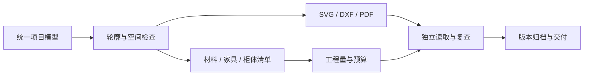

# 15个室内设计Skills：这次升级验证了什么

这次把主要价值推进到了可检查的交付链：换一套户型，图纸能够读取新的轮廓和对象；改一组柜体，平面、立剖、清单与费用能够一起更新。

15个Skills仍负责完整流程。本轮集中增强总控、平面、图纸、预算及校审5个环节，新增84㎡ L形测试「折庭」，保留96㎡住宅「栖木之家」的原交付。

## 从案例固定值到项目参数

| 原来的问题 | 本次改动 | 对日常工作的意义 |
|---|---|---|
| 总尺寸和分尺寸写在图纸代码里 | 从轮廓及分区边界计算 | 换户型时减少逐处修改图面的需要 |
| 柜体立剖固定为案例编号和尺寸 | 选择柜体编号，用正面、深度、高度和板材参数生成 | 柜体图与清单使用同一对象 |
| 材料编号决定铺装线 | 材料自带铺装间距参数 | 更换编号或规格仍能表达对应铺装 |
| 厨卫设备使用示例坐标 | 只画模型明确提供的设备，可省略淋浴 | 不把上一项目的设备带进下一项目 |
| 计数项需要手填 | 增加灯具、点位、设备和开口集合计数 | 对象增减可以传递到计价数量 |
| 校验器默认原住宅尺寸与页数 | 通用二维核验与原案例核验分开 | 新项目按自身模型检查 |

## 用一项修改检验交付一致性

折庭轮廓84㎡，包围框94.5㎡。这组差异检查了凹口是否被误算为室内面积。新户型采用不同对象编号和偏移坐标，并省略可选淋浴对象，检查绘图能否摆脱原案例常量。

CAB-A衣柜从2200×600×2200mm调整到2600×600×2450mm。读取实际导出文件后，得到以下结果：

| 结果 | 修改前 | 修改后 |
|---|---:|---:|
| 计价投影面积 | 4.84㎡ | 6.37㎡ |
| 柜体估算 | 5082.00元 | 6688.50元 |
| 项目含预备费估算 | 180288.72元 | 182055.87元 |

家具图、柜体立剖、DXF、家具与柜体清单、预算CSV、工作簿和PDF同步改变。房间清单保持一致。故意将模型改为未导出版本时，核验器会提示来源已过期。它能帮助团队定位“改了设计但仍在使用旧图”的具体问题。

## 价值排序更清楚了

1. **交付一致性**：同一对象连接图纸、清单与费用，复查有明确位置。这是当前证据最充分的价值。
2. **跨项目复用**：矩形与L形、不同编号和坐标均完成二维验证，减少复制上一案例再逐项替换的依赖。
3. **版本与责任可追踪**：旧版文件、变更对象及实际输出哈希分别保存。本轮只记录实际执行的5个阶段。
4. **工具可交接**：预算作者与二维核验器随对应Skills一起安装；更新前识别已知版本，保留旧文件，遇到未知本地内容时停止。

新案例有26行预算，其中21行由模型规则计量。墙面等5行暂估仍保留明确输入。46项行为测试覆盖空间、引用、计量、变更与安装；新图集8页和工作簿均检查实际文件及视觉结果。

这组Skills适合继续积累“输入条件—模型对象—交付文件—复核证据”的工作资产。本轮建立的是二维复用与变更证据，没有人工设计工时对照，也未扩展第二案例三维或原始CAD自动识别。

复现命令、参数边界和验收结果分别在README、共享项目契约及VALIDATION；逐项证据在TEST-L-084/state/change-verification.json。
