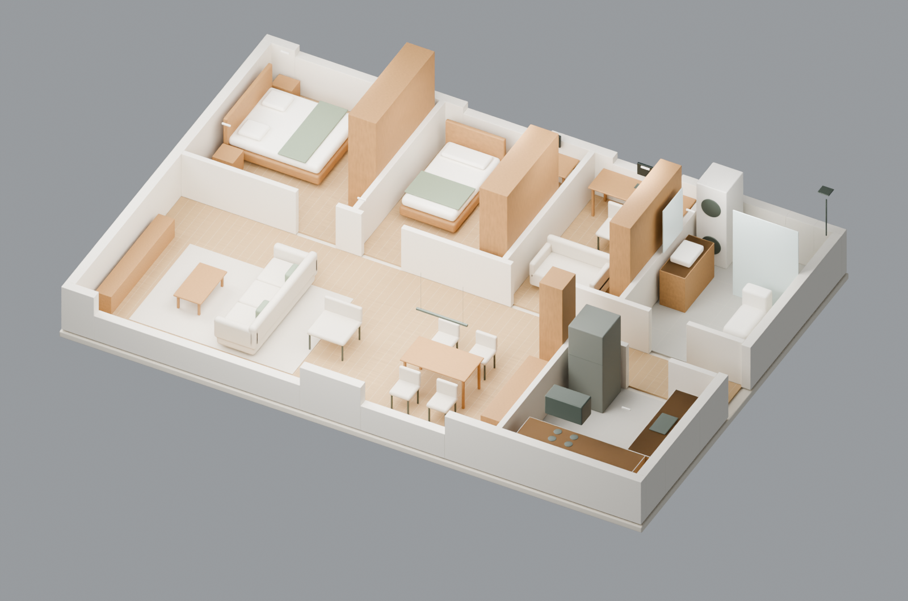

# 栖木之家 · 96㎡住宅示范

最终设计v1.1，2026-10-26。两卧加书房、三口之家、原木浅色；用户选定示范类型，尺寸和单价采用明确的设计设定。完成范围为设计文件及现场配合准备。

## 先看这三份

1. [方案与深化图集](documents/栖木之家_方案与深化图集.pdf)：12页A3横版，前6页方案，后6页图纸。
2. [可重算预算](schedules/栖木之家_预算.xlsx)：2个工作表、40行计价，蓝色数值可调整。
3. [可编辑CAD图纸](drawings/interior-set.dxf)：6组图，模型空间1:1，毫米。

## 设计结果

| 项目 | 最终值 |
|---|---|
| 内侧轮廓 | 12000×8000mm，96.0000㎡ |
| 净分区合计 | 92.5344㎡ |
| 功能 | 客餐厅、厨房、主卧、儿童房、书房兼客房、卫浴洗衣、玄关走廊 |
| 设计对象 | 30个家具/定制/设备体量，10种材料 |
| 灯光与设备 | 28盏/条灯、14个控制组、11项设备、12处条件点位 |
| 基础估算 | 261,734.18元 |
| 10%预备费 | 26,173.42元 |
| 总估算 | 287,907.60元 |
| 相对30万元余量 | 12,092.40元 |

家具与图纸围绕稳定编号组织。餐桌缩至1400mm后侧向净距800mm；冰箱电源移到可维护位置；客厅转向西侧实墙，保留南窗。3项问题分别留有初稿、修改与复查证据。

## 文件关系

- `model/project.json`：几何、材料、家具、灯光、设备、点位和预算输入的主文件。
- `01-brief.md`至`14-delivery.md`：14个专业阶段；总控计划在`state/project-plan.md`。
- `drawings/`：6张SVG、1份DXF及配对生成源码，图纸目录见`10-drawings.md`。
- `visuals/`：3幅同源图、Blender源场景、GLB交换模型、冻结输入和相机清单。
- `schedules/`：房间、材料、家具、灯具、设备、点位、预算CSV与预算工作簿。
- `state/`：执行日志、校审与变更台账、模型/文件/工作簿检查及交付哈希。
- `history/`：v0.1及v1.0历史输入；`delivery-templates/`：交底、送样、变更及现场记录模板。

最新阶段记录的输入和输出哈希已核验。早期日志保留各阶段当时的输出哈希，文件修订后的有效哈希以同一技能最后一项记录为准。

复算和重建命令见[套件README](../../README.md)，检查证据见[VALIDATION](../../VALIDATION.md)。更改模型后应重新生成受影响图纸、清单、模型与预算，再追加阶段记录。

采购为`not_ordered`，现场为`not_started`；真实项目接入时先补充现场复尺、结构与机电条件及产品安装资料。
